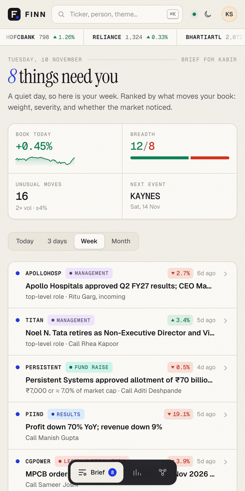
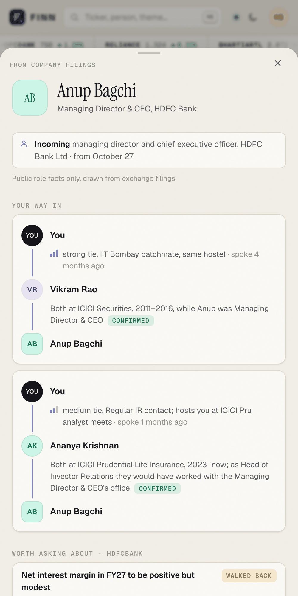
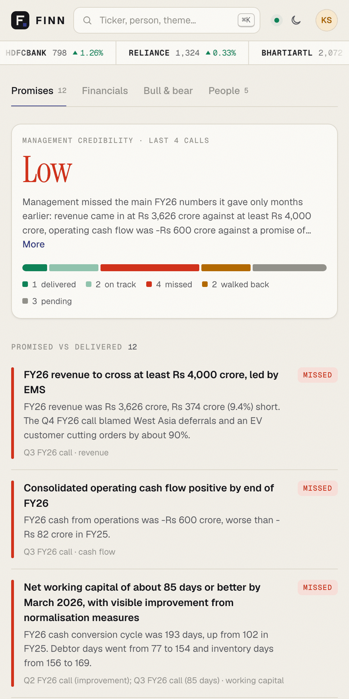
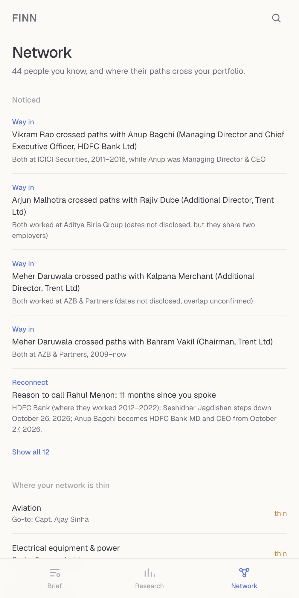
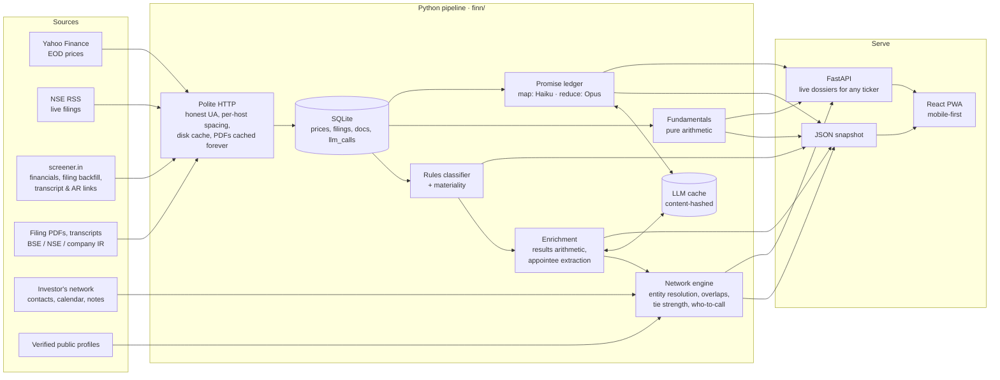

# FINN:a financial investment agent

**What changed in my portfolio, what the company actually said, and who I know who can explain it.**

FINN is a mobile-first prototype built for the ENAM Founding AI Engineer challenge. It runs on real NSE data
(prices, exchange filings, earnings-call transcripts, standardised financials) for a 20-stock mock portfolio
and any other NSE ticker, plus a fictional investor's network of 44 people overlaid on real executives
named in this month's filings.

- **Prototype:** `<deployed link>` · open it on a phone
- **Run it locally:** [two commands](#run-it)
- **Writeup for the covering email:** [docs/covering-note.md](docs/covering-note.md)

<p align="center">
  
  
  
  
</p>

---

## A three-minute tour

1. **Brief.** The last day was quiet, so FINN opens on the week: "8 things need you." Cards are ranked by materiality × position size, and each one shows how the stock reacted.
2. **HDFC Bank: new MD & CEO** (switch to *Month*, or tap the first item under *Network → Noticed*). FINN reads the filing, attaches a verified profile of Anup Bagchi, and finds your way in: *Vikram Rao, your IIT batchmate, was at ICICI Securities 2011–16 while Bagchi ran it.*
3. **PI Industries: results.** Revenue, EBITDA, PBT and PAT, QoQ and YoY, from the filing. The card also notes that *other income is 35% of PBT* and that the stock fell 19% on 30× volume the next session.
4. **CG Power: plant closure order.** *Call Sameer Joshi: he ran the Waluj plant 2013–20.* He's ranked first because the event names his site.
5. **Research → Kaynes → Promised vs delivered.** Management credibility: **low**. They promised ≥ ₹4,000 cr FY26 revenue and delivered ₹3,626 cr; they promised positive operating cash and posted −₹600 cr. Every row links to the transcript page it came from.
6. **Network.** What it noticed: paths to new directors, reasons to reconnect, a Kaynes trading-window caution, and themes you own with thin coverage.
7. **Ask** (search icon, or `/`): "way in to Anup Bagchi", "who knows rural lending?", "who can explain Polycab?", or any ticker. Voice works on supported browsers.
8. **Alerts** (tap the thresholds next to *Unusual moves* on the Brief). Drag the volume/price thresholds and watch the noise check update: how many alerts you would have had over the last 90 sessions.

---

## What I built and why

### The point of view

Investors don't need more information; they need less, ranked, with a next step. Three rules shape FINN:

1. **The Brief is finite.** It opens with a count ("3 things need you"), shows the top five, lets you clear cards, and ends with *you're caught up*. It also says what it filtered: routine filings, folded. Default window is 24 hours; when that was quiet it says so and opens on the week.
2. **Every card ends with a person.** The Network is not a separate contact app. It appears on the card at the moment it matters: *who can explain this*, or *your way in*. Wherever a person appears, the note carries the same thin blue rule, so the third layer is visible at a glance.
3. **Answers are objects, not paragraphs.** Ask returns a dossier, a path to a person or a list of experts, all actionable. It is not a chat transcript.
4. **Calm by design.** One typeface, one accent colour, three tabs. Colour appears only where it means something: green and red on numbers, blue on people. Everything else is one tap away, not on the screen.

### What FINN shows, how, and why

One rule decides every pixel: **each block opens with its conclusion, and that conclusion is arithmetic, not model prose.** The numbers sit underneath, for anyone who wants to check.

| On screen | What it is | How it's shown | Why |
|---|---|---|---|
| Brief headline | Count of open stories in the window | "8 things need you"; opens on the week when the last day was quiet | An end state, not a feed. A blank first screen tells you nothing |
| Story title | Exchange digest, or for results with a boilerplate digest, the result itself | "Profit down 70% YoY; revenue down 9%" instead of "Board approved results…" | The change is the news; the filing's own words stay underneath |
| Why it ranks | The one specific materiality reason | "₹7,000 cr ≈ 7% of market cap", "relief / stay granted" | Reasons true of every card ("a category you watch") are hidden: they explain nothing |
| Market reaction | First session after the filing | "−19% next session, 30× volume", coloured only past ±3% | Did the market care? Small moves stay grey so big ones stand out |
| Results table | Revenue, EBITDA, PBT, PAT · QoQ · YoY | Tabular figures, signed and coloured; up to two warnings below | Warnings ("other income is 35% of PBT") lead; the margin line the table already implies goes last |
| The person | Incoming executive, or who can explain the event | One note with a thin blue rule, never a list | One name you can call beats ten you might |
| Unusual moves | Price/volume past your thresholds | Ticker, move, volume multiple, and the filing that explains it | "No filing explains this move" is the most useful line on the screen |
| Transcripts | New earnings calls | One line of tickers, not one row each | The event is "FINN read it and updated the ledger", not the upload |
| Dossier numbers | Mkt cap, P/E, ROCE, margin; for lenders P/B and ROE | Four figures, no decoration | Banks are judged on equity returns and book value; ROCE misleads for a lender |
| Lenders (banks, NBFCs) | Net interest income and gross/net NPA instead of revenue, EBITDA and margin | Results card: Revenue · NII · PBT · PAT, with asset quality as the first note; dossier: NII and NPA by quarter, "Bad loans falling: gross NPA 1.11%, down 13 bps in a year" | A lender has no EBITDA, and fee income is core business, not a warning. Same four lines for every lender, so banks compare bank to bank. Banks report NPA standalone, so FINN takes it from there when the consolidated page is blank |
| Promise ledger | Every checkable commitment, judged | Verdict word, then the bar, then rows: **misses first** | A broken promise changes a view; a pending one doesn't yet |
| Charts | Revenue with margin; profit vs operating cash | A computed sentence above each: "₹977 cr of profit over five years, yet operating cash was −₹615 cr" | A chart without its point makes the reader do the analysis |
| Balance sheet | Borrowings, net worth, leverage | Verdict first: "Low leverage: debt is 0.19× equity" | Three numbers mean nothing until someone says what they mean |

### Push: the app reaches out

| | How it works |
|---|---|
| **Filings → categories** | 28 ordered rules over the exchange subject line and one-line digest classified all 120 filings in the snapshot, for free. When the subject is boilerplate ("Press Release", "Meeting Updates"), the digest leads. Only filings the rules can't place go to a cheap model. |
| **Materiality, explained** | Base weight per category, then adjustments with reasons: *top-level role*, *₹4,265 cr ≈ 4.3% of market cap*, *routine treasury*, *relief / stay granted*, *category you watch*. L&T's disclosed order bands ("significant" = ≥ ₹1,000 cr) are understood. Each card shows its reasons. |
| **Stories, not filings** | A board meeting produces three filings (results, a CEO exit, a divestment). Material filings for one company within 36 hours become one story, enriched by its most important part. |
| **Results card** | Revenue / EBITDA / PBT / PAT, QoQ and YoY, from the standardised quarterly results with a link to the filing. Arithmetic flags: margin moves in bps, other income carrying profit, unusual tax rates, profit growth far ahead of revenue. |
| **Management-change card** | A cheap model reads the filing's annexure for each person's role, change, career and education. A verified public profile is merged in where the filing defers to an earlier one. Then the Network finds paths. |
| **Material event card** | The person best placed to explain it, ranked on the event's own words. "Waluj" in the order and "Plant Head, Waluj" in someone's title is the strongest signal there is. |
| **Signals** | End-of-day price and volume vs a 20-session average, against your thresholds. Each signal is linked to the filing that explains it, or flagged *"No filing explains this move"*, which is itself worth knowing. |
| **Market reaction** | Every story shows the first session after the filing (after-close filings roll to the next day). |
| **Compliance sense** | A company that filed "trading window closed until results" gets a caution: *don't call current insiders until 14 Nov.* Anyone currently employed at the company is tagged with a SEBI insider-trading reminder. |

### Pull: ask it to dig in

Works for **any NSE ticker** screener.in covers. Not hard-wired: point it at a company I didn't pick.

- **Computed, never generated:** snapshot, trajectory (3/5/10-year CAGRs, margin trend, quarterly YoY), balance sheet (D/E, CWIP, working-capital days), cash quality (CFO vs PAT, 5-year conversion, FCF), ownership. Flags carry their numbers: *Debtor days rose from 74 to 154 in three years.* *₹977 cr of profit over five years, yet operating cash flow was −₹615 cr in total* (both Kaynes). Banks get bank-appropriate treatment.
- **Promised vs delivered** (the centrepiece): the last four earnings calls are read for every checkable commitment, each with a verbatim quote and page. One stronger model call then judges each promise against the reported numbers: *delivered, on track, missed, walked back, pending,* or *can't verify*. It also lists current guidance (new, reiterated, raised or cut), where the story and the numbers diverge, a credibility verdict, and a bull and bear case. Every row links to the transcript page.
- **Business snapshot:** segments and KPIs from the latest call.
- **Primary sources only.** Prompts forbid outside knowledge; the model sees only the transcripts and the reported numbers. When management doesn't publish transcripts (Trent), FINN falls back to its investor presentations and says so.

### The Network: who can help me understand this

- **Inputs** (what FINN asks for at onboarding): your schools and employers, your contacts with how you know them and when you last spoke, and company meetings from your calendar. In production these come from your LinkedIn connections export, calendar and CRM.
- **People from filings** are added automatically, using only public-role facts with a source link.
- **Entity resolution:** free-text employers ("ICICI Securities Limited", "Larsen and Toubro") resolve to canonical orgs (alias table, then fuzzy match); names are normalised.
- **Evidence with confidence:** *confirmed* (tenures overlap by date), *likely* (two shared employers, dates undisclosed), *possible* (one shared employer). Sharing a group ("both Tata") is not evidence; neither is a contact sharing an employer with someone who joined this year. FINN never claims two people know each other; it shows where their paths crossed.
- **Tie strength:** relationship type × recency (halves each year of silence) + frequency.
- **Who should I call:** former insiders first (fresher is better), then competitors, value chain, and topical experts (lawyers for insolvency, ex-regulator for a pollution order, ECM banker for a QIP). Weighted by function fit for the event and your tie.
- **Scenarios built:** second-degree paths to new executives; diligence on people (career, sources, paths); an expertise map with blind spots weighted by position size; going-cold contacts with a reason to call; a drafted note you can copy into WhatsApp; logging a call.

---

## Architecture



### Data pipelines

| Source | How | Refresh | Stored |
|---|---|---|---|
| Prices & volume | `yfinance`, one batched call for all `.NS` tickers | EOD (17:15 IST) | `prices` table |
| Filings, live | NSE's public announcements RSS (official, machine-readable; holds a few hours) | every 5 min in market hours | `filings` (source `nse_rss`) |
| Filings, history | screener.in company page: latest filings with exchange PDF links | with each company refresh | `filings` (source `screener`) |
| Fundamentals | screener.in: standardised quarterly & annual P&L, balance sheet, cash flow, ratios, shareholding, plus links to every transcript and annual report | daily, 12h cache | `companies` (parsed JSON) |
| Documents | PDFs downloaded once, text extracted per page (so citations can point at pages) | immutable, cached forever | `documents` |
| Network | investor-supplied files; filing people added by the pipeline | on change | in-memory graph, rebuilt each run |

**Linking a filing to a person in your network.** The filing's PDF goes to the cheap model, which returns the people with role, change, career orgs and years, and the page. Names are normalised and matched against verified public profiles. Career orgs resolve to canonical orgs. The overlap engine compares tenures against every contact. This happens on the push path, so the path is ready when the card arrives.

**Honest scraping.** Every request carries an honest User-Agent, per-host spacing (2.5s for screener), and is cached. NSE's JSON API only answers clients that imitate a browser session, so I used NSE's official RSS feed instead. Production would use a licensed feed: an exchange data vendor, the BSE/NSE paid APIs, or a provider like Trendlyne/CMOTS.

### LLMs: which step, which model, why

There are no autonomous agents. Each model call is a single, schema-constrained step inside a workflow the code controls. The tasks are well specified and errors must be traceable, so a planner loop would add cost and failure modes without adding quality. (Where an agent *would* earn its place is under [next](#where-id-take-it-next).)

Two tiers, and the code only ever asks for a tier. The committed snapshot was generated with Claude (Haiku for *cheap*, Opus for *strong*) through a local Claude Code install. The deployed server serves the same tiers from the Gemini free tier (Flash-Lite and Flash), so a judge can open any new ticker at no cost.

| Step | Tier: snapshot / live | Why this tier | Calls in the snapshot |
|---|---|---|---|
| Classify filings the rules can't place | cheap: Haiku / Flash-Lite | a label from two lines | 0 (rules covered all 120) |
| Extract appointees from a filing | cheap: Haiku / Flash-Lite | reading a structured annexure | 7 |
| Extract commitments from a transcript (map) | cheap: Haiku / Flash-Lite | bulk extraction over ~16k tokens | 95 |
| Business snapshot | cheap: Haiku / Flash-Lite | short structured summary | 23 |
| Judge promises vs numbers, story vs numbers, bull/bear (reduce) | strong: Opus / Flash | multi-document reasoning and arithmetic; this is where quality matters | 40 (24 companies, some re-run while tuning) |

**Efficiency, in practice:**
- *Rules before models:* classification and materiality cost nothing; the cheap-model fallback was never needed for this snapshot.
- *Prefiltering:* transcripts are cut to forward-looking sentences plus context before extraction, which removes 50–70% of tokens.
- *Map with the cheap model, reduce with the strong one:* the expensive model sees ~10k tokens of extracted commitments, never raw transcripts.
- *Content-hash cache:* each filing, transcript and judgement is computed once, ever. Rebuilding the snapshot makes zero model calls. The cache is committed (`data/llm_cache.jsonl`), so a fresh clone rebuilds for free.
- *Structured outputs* (JSON schema), so nothing is parsed with regex, plus prompt caching on the fixed system prompts.
- *Server-side fallback* on the strong tier, so a refusal doesn't sink a dossier.

**What it cost:** the whole snapshot (24 dossiers, 4 calls each, plus appointee extraction) was **$9.93** at list prices over 165 calls, about **$0.41 per company**. 96% of that is the Opus judgement step; all 125 cheap-tier extraction calls together cost $0.39. On the Gemini free tier the same pipeline costs nothing.

**How it runs without a paid key:** the model layer sits behind one interface. Live, it calls a free OpenAI-compatible endpoint (Gemini free tier by default; Groq and OpenRouter also work) via `LLM_API_KEY`. Every answer is cached by content hash and committed, so rebuilding the snapshot makes zero calls.

### Data security & privacy

The network is the sensitive part, so it is designed as **one investor's private workspace**, not a shared graph.

- **Isolation.** Each investor's contacts, notes and tie scores live in a per-tenant store (row-level security keyed on the workspace; a separate encryption key per tenant via KMS). Nothing from one investor's network is ever used to answer another's query, and the model is never fine-tuned on it.
- **What is stored about people.** For contacts: what the investor gave FINN (name, roles, schools, how they know them, last-contact date), nothing scraped. For people in filings: only public-role facts from the company's own disclosure or a verified public profile, each with a source link. No contact details, no personal data beyond professional history.
- **Retention.** Filing people are kept while they hold a role in a tracked company plus 12 months. Contacts are kept until the investor removes them; deletion is hard and cascades to derived scores. Raw PDFs are public documents. Model calls go to a provider under a zero-retention agreement.
- **Consent.** The investor imports their own data (LinkedIn's member data export, calendar OAuth with read-only scope). Enriching a contact's profile beyond what the investor supplied would require that contact's consent or a licensed provider with a lawful basis under India's DPDP Act.
- **Access control.** SSO with MFA, per-workspace roles (owner, analyst, read-only), audit logs on every network query and export. Production keys live in a secrets manager.
- **Compliance by design.** Insider-trading cautions on current employees and trading windows are built into the product, not left to memory.
- **In the prototype:** the network is fictional and ships as JSON; per-viewer state (cleared cards, thresholds, logged calls) stays in the browser's localStorage.

### Cloud: what runs where

| Piece | Prototype | Production |
|---|---|---|
| App | Static PWA (Vercel), works offline from the snapshot | same, behind a CDN |
| API | FastAPI in one container (Render / Fly / HF Spaces) | containers on Cloud Run / ECS, autoscaled |
| Pipeline | CLI, run by hand | scheduled jobs: RSS poller every 5 min in market hours, EOD refresh at 17:15 IST, transcript processing on arrival (queue-driven) |
| Storage | SQLite + JSON snapshot | Postgres (filings, prices, network, row-level security) + object storage for PDFs and snapshots |
| Models | Free-tier open models (Groq/OpenRouter/Gemini) | A paid provider with zero retention, or a self-hosted model in `ap-south-1` for data residency |
| Push delivery | in-app | Web Push / WhatsApp Business / email digest, per the investor's rules |

Data stays in India (`ap-south-1` / `asia-south1`). The static snapshot means the demo can never be down.

---

## Real vs synthetic, plainly

- **Real:** prices, filings (120 across 24 companies, 21 Sep – 9 Nov 2026), PDFs, financials, transcripts, and every executive named in a card (from the filing itself). The three people whose profiles the filings defer elsewhere (Anup Bagchi, Bahram Vakil, Leo Puri) carry public-role facts I verified against the cited public sources.
- **Synthetic:** the investor (Kabir Sethi, Northfield Capital) and their 44 contacts. Their careers place them at real companies at plausible times, so overlaps with real filings can be shown. None of these people exist, and no claim is made that any real person knows them.
- **How I'd do profiles for real:** the investor's own LinkedIn export and calendar for the network; a licensed people-data API (or the investor's CRM) for enrichment with consent; filing annexures for executives, which is what FINN already does.

## Deliberately left out

- **Annual-report deep reads** (contingent liabilities, related-party transactions, auditor remarks). The plumbing (per-page PDF text) is there; I chose depth on promises vs delivery over breadth.
- **Accounts, multi-user, push delivery.** Per-viewer state is local; rules run in the app.
- **A free-form chat.** The Ask bar routes to structured answers on purpose.
- **Secondary data** (news, broker notes) on the research side, by design.
- **A network hairball graph.** Paths with evidence beat a pretty graph you can't act on.

## Where I'd take it next

1. **A research agent for open questions** ("why did margins fall?"), with tools over the same primary documents and the computed metrics, citing pages. This is the one place open-ended planning pays for itself.
2. **Annual-report red flags** using the same map/reduce pattern, plus **segment data** from investor decks, which would turn many "can't verify" ledger rows into verdicts.
3. **Learning materiality from behaviour:** what the investor opens, clears and acts on re-weights the scorer per person.
4. **Relationship memory:** log calls by voice, extract what was learned, and attach it to the company dossier.
5. **Licensed real-time feeds** and true push.

---

## Run it

```bash
# backend (Python 3.12+)
python -m venv .venv && .venv/bin/pip install -r backend/requirements.txt
cd backend && ../.venv/bin/python -m finn.pipeline all     # fetch + build snapshot (cached model answers make this free)
../.venv/bin/uvicorn finn.api:app --port 8000              # API, live dossiers for any ticker

# frontend
cd frontend && npm install && npm run dev                  # http://localhost:5173 (proxies /api)
```

- With `LLM_API_KEY` (a free Gemini key from aistudio.google.com) set, new tickers get the model sections too; without it they render the computed sections and say what is missing.
- Tests: `cd backend && ../.venv/bin/python -m pytest` (31 tests over the classifier, materiality, money parsing, results arithmetic, the overlap engine and the flags).
- Docker: `docker build -t finn . && docker run -p 8000:8000 finn`.

## Repository map

```
backend/finn/
  sources/      screener.py (parser), prices.py (yfinance), nse_rss.py, documents.py (PDF → page text)
  push/         classify.py (rules + materiality), enrich.py (results, appointees), brief.py (stories), alerts.py
  pull/         fundamentals.py (arithmetic), guidance.py (promise ledger), dossier.py
  network/      engine.py (resolution, overlaps, tie strength, who-to-call, expertise, reconnect)
  llm/client.py one door to models: tiers, providers, cache, cost ledger
  pipeline.py   CLI: refresh / poll / snapshot · api.py FastAPI
backend/tests/  deterministic core
data/inputs/    portfolio + the investor's network (synthetic) + verified public profiles
data/snapshot/  the JSON the app runs on · data/llm_cache.jsonl  every model answer, reusable
frontend/src/   React + TypeScript, no UI kit, hand-built SVG charts
```

## How this was built

Built with Claude Code; the session transcript is part of the submission. It shows the course corrections made along the way, each checked against real filings rather than assumed:
- Dropped NSE's browser-only JSON API for its official RSS feed.
- Found that a severity rule fired on "dis*closure*", and that customer counts ("28.5 lakh customers") were read as rupees.
- Stopped crediting "both in the Tata group" and "both at Apollo since last month" as evidence.
- Switched the transcript prefilter from paragraphs to sentences when it was only saving 10%.
- Gave the reasoning step working-capital days once it said it couldn't check a working-capital promise.
